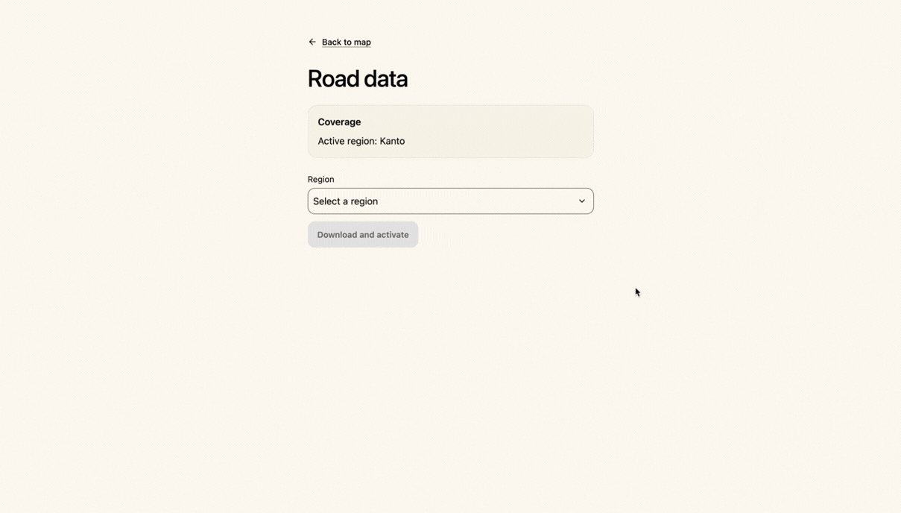

# Virtual Pipe



[](LICENSE)

A local development tool for generating and exporting synthetic pipe data for a district in Japan.

## Motivation

I got the idea from a couple of things I noticed at work:
- We need realistic data for customer demos, but we can’t use real customer data for compliance reasons.
- When a new feature or product updates pipe attributes, it often takes a while to prepare real data with those attributes.

## Local setup

- [GNU Make](https://www.gnu.org/software/make/)
- [Docker with Compose v2](https://docs.docker.com/compose/install/)

1. For district search, copy the five `N03-20260101` files (`.shp`, `.shx`, `.dbf`, `.prj`, and `.cpg`) into `data/`. [Nationwide MLIT download](https://nlftp.mlit.go.jp/ksj/gml/datalist/KsjTmplt-N03-2026.html)
2. From the repo root, run `make up`.
3. Open [localhost:5173](http://localhost:5173).
4. Open **Manage road data**, pick a region, and select **Download and activate** (or **Activate** if it’s already downloaded). Shikoku is a good first region.

To import road data from the terminal, use the same code for `<region>` in commands. Choose `hokkaido`, `tohoku`, `kanto`, `chubu`, `kansai`, `chugoku`, `shikoku`, `kyushu`, or `japan` for nationwide coverage.

```sh
make osm:download REGION=<region>
make osm:import REGION=<region>
```

Run `make down` to stop the app.

## Local development

- [Node.js 24.12+](https://nodejs.org/en) and [pnpm 10.32.1](https://pnpm.io/)
- [Python 3.14](https://www.python.org/downloads/) and [uv](https://docs.astral.sh/uv/)

From the repo root:

```sh
pnpm --dir client install --frozen-lockfile
uv sync --project server --locked
```

| Task             | Client                     | Server                     |
| ---------------- | -------------------------- | -------------------------- |
| Format           | `make client:format`       | `make server:format`       |
| Check formatting | `make client:format:check` | `make server:format:check` |
| Lint             | `make client:lint`         | `make server:lint`         |
| Run tests        | `make client:test`         | `make server:test`         |

Keep Docker running for server tests and code generation. After changing the API, regenerate the schema and client:

```sh
make server:schema
make client:api:generate
```

## Credits

- English municipal names were built using data from [JPGovStat](https://github.com/kensukesuzuki04/JPGovStat).
- Japan road extracts are provided by [Geofabrik](https://download.geofabrik.de/asia/japan.html).

## License

[MIT](LICENSE)

- Road and map data © OpenStreetMap contributors. [Open Database License](https://www.openstreetmap.org/copyright)
- Japan’s 2026 administrative boundaries come from the Ministry of Land, Infrastructure, Transport and Tourism (MLIT) and are licensed under CC BY 4.0. [Dataset and terms](https://nlftp.mlit.go.jp/ksj/gml/datalist/KsjTmplt-N03-2026.html)

Copyright (c) 2026-present, Akinori Hoshina
